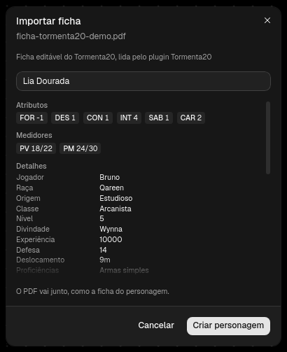
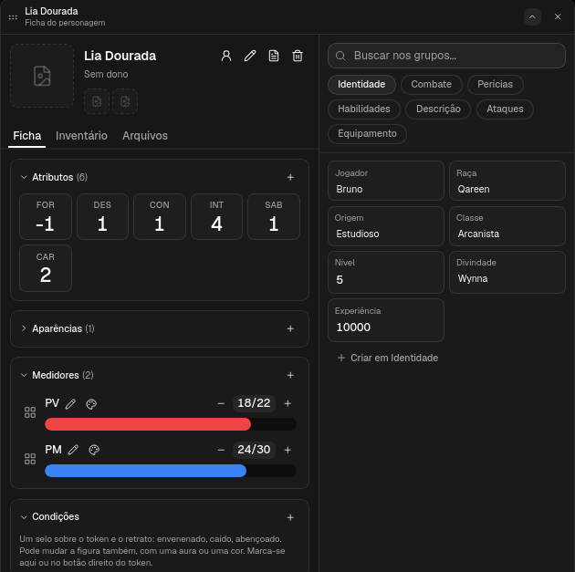
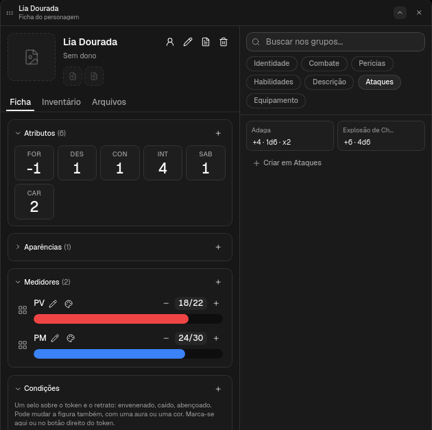

# Tormenta20 para o ATO20

Plugin que ensina o ATO20 a ler a ficha editável do Tormenta20. Na lista de
Personagens, **Importar ficha em PDF** cria o personagem a partir dela, com o
PDF anexado como a ficha dele. É só o `manifest.json`, sem código.



## A ficha

O plugin lê a ficha **editável** (com formulário), a que tem os campos
`NOME DO PERSONAGEM`, `ModFor` e `PMs Totais`. A impressa, a digitalizada e a
que não tem formulário continuam entrando como anexo.

O PDF da ficha não vem no plugin: ela é da Jambô Editora.

## O que vira o quê

| Na ficha | No personagem |
| --- | --- |
| Nome | o nome |
| FOR, DES, CON, INT, SAB, CAR | atributos, pelo modificador (`ModFor`...), como no Jogo do Ano |
| PV e PM, atuais e totais | medidores PV e PM |
| Jogador, raça, origem, classe, nível, divindade, experiência | detalhes em Identidade |
| Defesa, deslocamento, armadura, escudo, proficiências | detalhes em Combate |
| As 30 perícias, pelo total | detalhes em Perícias |
| Habilidades de raça e origem, de classe, magias | detalhes em Habilidades |
| Descrição e anotações | detalhes em Descrição |
| Ataques (bônus, dano, crítico, tipo, alcance) | uma linha por ataque em Ataques |
| Itens e peso, tibares | Equipamento |





O modificador e o total das perícias são calculados pela própria ficha. Quem
preenche num leitor de PDF que não recalcula (o navegador, a maioria dos
leitores no Linux) fica com eles desatualizados, e é isso que entra.

## Instalar

No ATO20: Configurações → Plugins → **Catálogo**, e **Instalar** no Tormenta20.
Quando sair versão nova, o mesmo botão vira **Atualizar**.

Pede o ATO20 com a API de plugins 10.

Num ATO20 sem o catálogo:

1. Clone o repositório (ou baixe o zip dele):

   ```
   git clone https://github.com/ato20-org/ato20.tormenta20.plugin
   ```

2. No ATO20, Configurações, Plugins, **Importar plugin**, e escolha a pasta.
